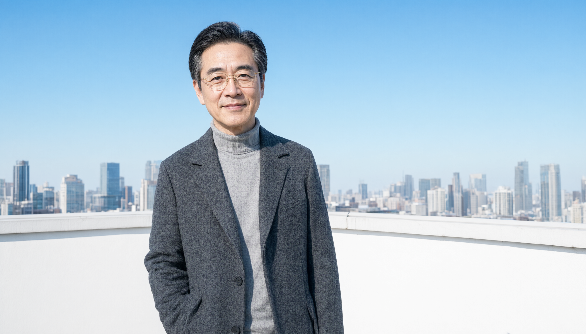

<nav class="cast-rail">
  <a href="xixi.html">← 上一位：西西</a>
  <a href="../index.html">← 返回首页</a>
</nav>

<section class="section-character">

<header class="char-header">
  

    DOSSIER 05
    
    

      <h2 class="char-name">陈合</h2>
      
CHEN HE

    

  

  
他不邪恶。他只是把意识当成了资产。

</header>

<figure class="still-plate">
  

    

      
      
PLATE 05 · 2.39:1

      
合流资本大厦天台 · 晴日正午 · 日 12:50

    

  

  <figcaption>LIGHT 正午强日光自画右正面入射，高调曝光、面部均匀受光提亮；蓝天与白色女儿墙反弹大量清亮补光吃净阴影，仅存极浅软影，通透无临床冷感。</figcaption>
</figure>

  
05.1<h3>档案</h3>

  <dl class="fact-list">
    
<dt>AGE / 年龄</dt><dd>50 岁</dd>

    
<dt>OCCUPATION / 职业</dt><dd>合流资本创始人；原理论物理研究所资助方代表；Ω-64 全部资产（含原始场域数据）的合法持有人</dd>

    
<dt>FORM / 存在形态</dt><dd>现实中的活人。仅出场两次：场景 13（视频通话）、场景 26–29（亲临）。</dd>

  </dl>

  
05.2<h3>外形细节</h3>

  
化妆 / 服装 / 道具组执行依据

  <ol class="numbered-list">
    <li>01 短黑发，鬓角修剪得极整齐，掺一点灰。</li>
    <li>02 金丝边眼镜，镜片永远干净——全剧没有一个人擦过自己的眼镜，只有他的镜片上没有指纹。</li>
    <li>03 面部保养良好，无皱纹，只有一点眼袋；微笑时嘴角上扬的弧度左右完全对称。</li>
    <li>04 双手无表、无戒、无手链。「我不需要知道几点，我需要知道还剩多少。」</li>
    <li>05 灰色羊绒高领毛衣 + 深炭灰西装外套，无领带、无口袋巾。</li>
    <li>06 黑色皮鞋。走在地下室水泥地上声音很脆，与老周的黑布鞋形成阶级对比。</li>
  </ol>

  
05.3<h3>性格内核</h3>

  
温和、体面、有教养。他的世界观只有一条：不能被算出来的东西，就等于不存在。他从不威胁人，他只报数字——「四百一十二次模拟，成功率百分之三十七」。他把「我们」挂在嘴边，因为「我们」可以稀释责任。他越温和越可怕。

  
05.4<h3>口头禅与标志性动作</h3>

  <blockquote class="catchphrase accent-steel">「我们。」／「这个词不准确。」</blockquote>
  <ul class="dash-list">
    <li>微笑。且微笑从不消失，只在场景 27 裂开一次（0.5 秒）。</li>
    <li>用钢笔笔尖轻点文件。他递钢笔，从不递铅笔。</li>
    <li>说话时音量从不超过对话对象。</li>
    <li>走进任何空间先环视一圈——他皱眉的不是破败，是蜡烛。</li>
    <li>把一切都说成「我们」：我们做过模拟、我们改了、我们需要。</li>
  </ul>

  
05.5<h3>核心秘密</h3>

  

    
CLASSIFIED · 剧透预警

    
他十九年前就见过西西。是他批准了那次 field test，也是他提出「需要一个外部监护人」。他记得那个孩子，但他把这段记忆归档为「一次成本已核销的资产损失」。场景 29 被带走时，他对老周说了唯一一句真话：「……她说的对。我的场是收的。」

  

  
05.6<h3>人物弧线</h3>

  <ol class="arc-list">
    <li>
<strong>掌控（视频通话，报数字，出价）</strong>场景 13
</li>
    <li>
<strong>亲临，递出钢笔与 37% 的成功率</strong>场景 26
</li>
    <li>
<strong>被一个九岁女孩当众拆解，微笑第一次出现裂痕</strong>场景 27
</li>
    <li>
<strong>四条价格曲线收敛成一个 ψ，他的世界观在屏幕上被物理性地否定</strong>场景 29
</li>
  </ol>

  
05.7<h3>表演基调</h3>

  

    
DIRECTION · 给演员与导演

    
他是全剧唯一被证伪而非被感化的角色。全程微笑，音量从不超过对话对象。禁止给他任何「反派式」的表情、语气或灯光提示——不用仰拍、不用底光、不用慢动作出场、不用阴间配乐。他的可怕来自体面。唯一一次失态是场景 29 后退一步撞在铁架上：那是他第一次被一个符号吓到。他没有悔改，他只是算不出来了。

  

</section>
