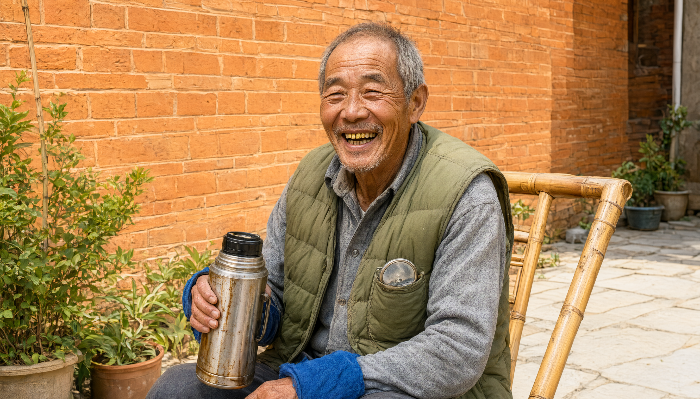

# 03 · 老周

> **全剧唯一不焦虑的人。他不懂理论，他懂到不需要理论。**



*文献库侧院 · 红砖墙竹椅旁 · 正午 13:40*

**灯光说明**：正午强日光高角度正面铺满整张脸，高调曝光；提亮的暖橙砖墙与石板地反弹大量暖光吃净阴影，仅存极浅软影，笑意明亮无压黑。2.39:1，35mm 胶片颗粒。

<p><strong style='color:#ac4923'>强调色 · ember</strong></p>

## 档案速览

| 项目 | 内容 |
| --- | --- |
| 年龄 | 63 岁（Ω-64 那年 37 岁） |
| 身份 | 城西文献库夜班保安兼锅炉工；原理论物理研究所清洁工 |
| 口头禅 | 「哎。对喽。」／「我不懂。」 |

## 存在形态

- 现实中的活人。闪回中以 37 岁蓝色工装清洁工形态出现（场景 10、18），无台词。

## 外形细节

- 军绿棉马甲，袖口磨破，自己用蓝线缝过，针脚很粗。
- 深灰长袖衬衫，蓝布裤，黑布鞋——鞋面刷得干净，走路没有声音（与陈合的皮鞋形成阶级对比）。
- 脸黑红，皱纹深，眼睛不浑；笑起来眼睛眯成两条缝，露一颗金牙。
- 不锈钢保温杯，杯壁一层茶垢，从不洗；拧盖时声音清脆可辨。
- 钥匙串上挂一面直径 3 厘米的小圆镜，镜背刻乾卦☰与坤卦☷。他没事就用绒布擦它。
- 手大，指节粗，掌心有锅炉房烫出的旧疤。

## 性格内核

慢，爱笑，说话绕。他不是「不懂理论的粗人」——他是懂到不需要理论的人。原文《通俗指南》的全部内容（镜子、回声、呼吸、日常经验、无需数学）就是他一个人的说话方式。他是全剧的定盘星：他不变，所以别人可以变。

## 标志性动作

- 拧保温杯盖。一圈、两圈——情绪越重，拧得越慢。
- 用绒布擦那面小圆镜，擦完对着灯照一照。
- 永远在干活，从不空手站着说话：扫地、加料、掏钥匙、擦管子。
- 给人倒茶，推过去，不问要不要。
- 每次说「我不懂」，紧接着就说出了全剧最准的一句话。

## 核心秘密

```{warning}
Ω-64 那晚他在场，推着拖把车经过走廊。他记得西西是自己走进去的，回头冲他笑，说「爷爷，你帮我看着爸爸。他老是忘记吃饭。」他记了十九年，从没跟人说过。他也是唯一十九年来一直在和地下二层的「回音」说话的人——他问它：锅炉为什么是圆的。
```

## 人物弧线

| 阶段 | 时间轴区间 |
| --- | --- |
| 不变 | 00:00 – 45:00 |
| 唯一的「变化」：把保温杯递给被铐走的陈合——他第一次对不该善待的人善待 | 38:00（场景 29） |

## 表演基调

语速比全剧所有人慢三分之一。所有台词都要在「干活」的间隙里说出来，不许停下来专门说话。他笑的时候真笑，眼睛眯起来；他难过的时候不演难过，只是把杯子拧得更慢。禁止给他任何「智者式」的深沉表情、禁止仰拍、禁止顶光。他是唯一一个从头到尾坐在同一把竹椅上的人。

## 关系网

- **沈西 / 西西**｜十九年的守夜人 · 唯一持续和她说话的人：他不知道那是谁，但他每天夜里下来烧锅炉，听见有人在里头念。他应她，她也应他——他就是她十九年里唯一的回声。
- **沈砚**｜下属、朋友，也是唯一敢命令他的人：「念一遍。」他让沈砚把自己的方程念了三遍，然后用一面镜子和一根铁管讲清楚了它。
- **林知微**｜他给她倒了杯水，然后告诉她「你也是回声」：他不安慰她。他只用粉笔在登记簿上画了六十四格，然后说：老祖宗画卦的时候，也在数不完。
- **陈合**｜一面之缘 · 一杯没被接走的茶：陈合被带走时停在他面前说「我的场是收的」。老周点了点头，把保温杯递过去。陈合没有接。

## 关键场次

| 场景 | 剧中时钟 | 事件 | 强度 |
| --- | --- | --- | --- |
| 04 | 23:02 | 从暗处摇进画面，举起小镜子说「您照照」；对楼梯口说了一句听不清的「来了」 | ★★ |
| 07 | 23:33 | 全剧最重要的一场：用镜子的无限递归和铁管回声讲清 ψ = ψ(ψ)；说出「念了十九年」 | ★★★★ |
| 14 | 00:44 | 用镜背乾坤二卦讲六十四卦 ↔ 每部六十四章；转述西西那句话，让林知微崩溃 | ★★★★ |
| 19 | 01:41 | 在两个失控的人中间走进来，把保温杯「当」地放在桌上，然后开始扫地上的稿纸 | ★★★ |
| 20 | 01:55 | 「你十九年不是在找她，你是在让她找你」；重放场景 04 那句「来了」 | ★★★★★ |
| 24 | 02:40 | 摇第七下启动柴油发电机；点四支蜡烛；说「还差一个」 | ★★ |
| 29 | 03:48 | 把保温杯递给被铐走的陈合——全剧最安静的一次善意 | ★★★ |
| 31 | 04:15 | 「psi。希腊字母。第二十个。念作——西。」第三层反转的钥匙在他手里 | ★★★★★ |
| 33 | 05:20 | 把小圆镜递给沈砚，完成「镜中 ψ 仍是 ψ」的物理证明 | ★★★ |
